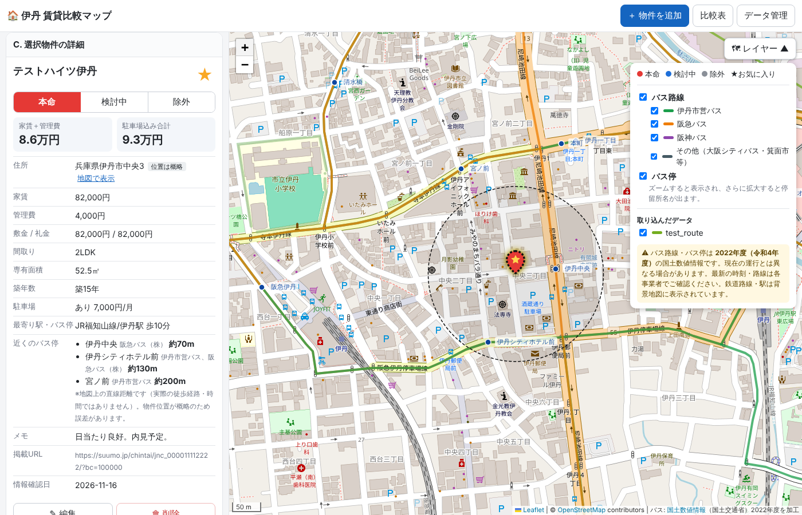

# 伊丹 賃貸比較マップ

兵庫県伊丹市周辺で、SUUMO などで見つけた賃貸物件を **地図に登録して比較する** ための、個人用 Web アプリです。
バス路線・バス停・鉄道駅と物件の位置関係を、一画面で確認できます。

- そのまま起動すれば、サーバー・ログイン不要で、データは **自分のブラウザの中だけ** に保存されます。
- **2人で共有モード**（v1.1〜）：Supabase と Cloudflare Pages（どちらも無料）を設定すると、あなたとパートナーの2人だけがログインでき、スマホ・PC間で物件データが自動同期されます。設定方法は **[docs/SHARING_SETUP.md](docs/SHARING_SETUP.md)** を見てください。
- 地図は OpenStreetMap、バス路線は国土交通省「国土数値情報」（2022年度）の公開データを使っています（どちらも無料）。



---

## 1. 起動手順（初心者向け）

### 準備（最初の1回だけ）

1. **Node.js をインストール**します。<https://nodejs.org/ja> から「LTS（推奨版）」をダウンロードしてインストールしてください（バージョン 20 以上）。
2. このフォルダ（`tujidoh`）を自分の PC に置きます（GitHub から「Code → Download ZIP」でも可）。
3. ターミナルを開きます。
   - Windows：フォルダを開いて、アドレスバーに `cmd` と入力して Enter
   - Mac：「ターミナル」アプリを開き、`cd ` と入力してからフォルダをドラッグ＆ドロップして Enter
4. 次のコマンドを実行します（必要な部品をダウンロードします。数十秒〜数分かかります）。

   ```bash
   npm install
   ```

### 起動（毎回）

```bash
npm run dev
```

表示された `http://localhost:5173/` をブラウザ（Chrome / Edge / Safari など）で開くと使えます。
終了するときはターミナルで `Ctrl + C` を押します。

> **注意：データはブラウザごとに保存されます。** 毎回同じブラウザ・同じアドレス（`http://localhost:5173/`）で開いてください。アドレスやブラウザが変わると、別のデータ置き場として扱われます。

### スマートフォンで使うには

- **同じ Wi-Fi 内で一時的に使う**：`npm run dev -- --host` で起動し、表示された `http://192.168.x.x:5173/` をスマホで開きます（PC とスマホのデータは別々です）。
- **常にスマホで使う**：`npm run build` で作られる `dist` フォルダを、GitHub Pages・Cloudflare Pages・Netlify などの無料ホスティングに置けば、どこからでも開けます（`dist` 内のファイルはそのまま置くだけで動きます）。

---

## 2. 画面の見方

| 場所 | 内容 |
|---|---|
| 上部 | 「＋物件を追加」「比較表」「データ管理」ボタン |
| 左パネル A | 絞り込み（家賃上限・間取り・面積・築年数・駐車場・ステータス・お気に入り） |
| 左パネル B | 候補物件の一覧（物件名・家賃＋管理費・間取り・★）。並べ替え：家賃／広さ／登録日 |
| 左パネル C | 選んだ物件の詳細と「編集」「削除」「お気に入り」「SUUMOで開く」 |
| 右の地図 | 物件ピン・バス路線・バス停。右上の「レイヤー」で表示切替 |

- ピンの色：**赤＝本命 / 青＝検討中 / グレー＝除外**。★マーク入りはお気に入り。選択中のピンは大きく光ります。
- 輪郭が点線のピン＋点線の円は「**位置は概略**」の物件です。
- **スマホ**では地図が全面表示になり、下のバー（「▲ 一覧・詳細を開く」）でパネルを開閉できます。

---

## 3. 物件の登録方法

1. 上部の **「＋ 物件を追加」** を押します。
2. **① SUUMOの物件URL** を貼り付けます。
   - 既に同じ URL の物件があると、⚠ 警告が出ます（重複登録の防止）。
   - URL だけでは情報を自動取得しません（SUUMO への自動アクセスは行いません）。
3. **② 掲載文章を貼り付け**（任意・おすすめ）
   - SUUMO の物件ページで、物件名〜駐車場あたりの文章をマウスで選択してコピーし、貼り付けます。ページ全体（Ctrl+A → Ctrl+C）でも構いません。
   - **「文章から自動入力」** を押すと、家賃・管理費・敷金・礼金・間取り・専有面積・築年数・住所・駐車場・最寄り駅・物件名を読み取って ③ に入力します。読み取れた欄は **黄色** になります。
   - 読み取れなかった項目は **空欄のまま**（推測で埋めません）。手入力してください。
   - 住所が読み取れた場合は、自動で地図上の位置も検索します。
4. **③ 物件情報** を確認・修正します。家賃・敷金・礼金は「万円」、管理費・駐車場料金は「円」で入力します。
5. **④ 地図上の位置**
   - 「住所から位置を検索」：国土地理院の住所検索で位置を設定します。丁目までしか分からない場合は自動的に「位置は概略」にチェックが入ります。
   - **「📍 地図をクリックして指定」**：フォームが一旦隠れるので、地図上の物件の場所をクリック（タップ）します。住所検索で見つからないときや、位置を微調整したいときに使います。
6. **「登録する」** を押すと、一覧と地図に反映されます。

登録後は、詳細パネルでステータス（本命／検討中／除外）やお気に入りをワンタップで変更できます。「編集」でいつでも修正できます。

### 比較表

上部の **「比較表」** で、候補を横に並べて比較できます（現在の絞り込み条件に合う物件のうち、除外以外が初期表示）。
家賃＋管理費、駐車場込みの月額合計、敷金＋礼金、㎡あたり家賃、築年数、最寄りバス停までの直線距離などを比べられ、最も条件の良い値が緑色になります。

### 距離の表示について

「近くのバス停」「最寄りバス停」の距離は **地図上の直線距離** です。実際の徒歩経路や所要時間ではありません（このアプリでは徒歩経路・所要時間は計算していません）。

---

## 4. バス路線データの設定方法

### 同梱データ（設定不要）

起動するだけで、伊丹市周辺のバス路線とバス停が表示されます。

| データ | 出典 | 年度 | ライセンス |
|---|---|---|---|
| バス路線 | 国土交通省 [国土数値情報 バスルート（N07）](https://nlftp.mlit.go.jp/ksj/gml/datalist/KsjTmplt-N07-2022.html) 兵庫県・大阪府 | **2022年度（令和4年度）** | CC BY 4.0 |
| バス停 | 国土交通省 [国土数値情報 バス停留所（P11）](https://nlftp.mlit.go.jp/ksj/gml/datalist/KsjTmplt-P11-2022.html) 兵庫県・大阪府 | **2022年度（令和4年度）** | CC BY 4.0 |

- 対象範囲：伊丹市・尼崎市北部・宝塚市南部・川西市南部・豊中市周辺（北緯34.725〜34.865度、東経135.33〜135.505度に掛かる路線・停留所）
- 収録事業者：伊丹市営バス（伊丹市交通局）、阪急バス、阪神バス、大阪シティバス、箕面市など
- 路線は事業者ごとに色分けされています：**緑＝伊丹市営バス / オレンジ＝阪急バス / 紫＝阪神バス / グレー＝その他**
- 路線をクリックすると事業者名が表示されます。N07 には **系統名が含まれない** ため、系統名はバス停をクリックして確認してください（P11 の属性）。
- ⚠ **2022年度時点のデータ** です。その後の路線変更・廃止は反映されていません。最新の路線・時刻は各事業者の公式サイトで確認してください。
- 鉄道路線と駅（JR福知山線・阪急伊丹線・阪急宝塚線・阪急神戸線など）は、背景の OpenStreetMap 地図で確認できます。

#### 兵庫県 GTFS-JP データについて（調査結果）

[兵庫県のGTFS-JPオープンデータ](https://web.pref.hyogo.lg.jp/ks05/gtfs-jp.html)（掲載ページ更新日 2026年5月28日、データは [GTFSデータリポジトリ](https://gtfs-data.jp/search?pref=%E5%85%B5%E5%BA%AB%E7%9C%8C) で配布）を確認したところ、2026年11月時点で **伊丹市営バス・阪急バスの GTFS は公開されていません**（伊丹周辺では宝塚市「ランランバス」、猪名川町「ふれあいバス」、西宮市のコミュニティバス等のみ）。このため、伊丹周辺を一通りカバーできる国土数値情報（2022年度）を同梱しています。

### 自分で GeoJSON を取り込む

上部の **「データ管理」→「GeoJSONファイルを選択」** で、路線（LineString / MultiLineString）やバス停（Point）を含む GeoJSON を読み込めます。

- 座標は経緯度（WGS84 / JGD2011、`[経度, 緯度]` の順）である必要があります。日本付近の座標でない場合はエラーになります。
- 複数ファイルを一度に選べます。取り込んだデータはブラウザ内（IndexedDB）に保存され、再読み込み後も残ります。
- 地図右上の「レイヤー」で表示・非表示を切り替え、「データ管理」で削除できます。
- 路線名は `route_long_name`、`route_short_name`、`route_name`、`name` などの属性から自動で表示します。

#### 新しいデータの作り方の例

- **GTFS-JP（新しい年度のデータが公開された場合）**：GTFS の zip を [QGIS](https://qgis.org/) の「GTFS Loader」プラグインなどで読み込み、`shapes`（路線形状）と `stops`（停留所）を GeoJSON 形式でエクスポートします。
- **国土数値情報の新年度版**：<https://nlftp.mlit.go.jp/ksj/> から N07（バスルート）・P11（バス停留所）の兵庫県・大阪府の GML(JPGIS2.1) 版 zip をダウンロード・展開し、次のコマンドで同梱データを作り直せます（Python 3 が必要）。

  ```bash
  python3 scripts/convert_ksj_bus.py N07-xx_28.xml N07-xx_27.xml --stops P11-xx_28.xml P11-xx_27.xml --out public/data
  ```

  年度が変わった場合は、`src/lib/busData.ts` の `BUILTIN`（ファイル名・年度表記）も更新してください。

---

## 5. データのバックアップ方法

物件データはブラウザの **localStorage** に保存されます。画面を再読み込みしても残りますが、次の場合は消えるので、定期的にバックアップしてください。

- ブラウザの「閲覧履歴データの削除」で Cookie・サイトデータを消したとき
- シークレット（プライベート）モードで使ったとき
- 別の PC・ブラウザで開いたとき（データは共有されません）

### バックアップ（エクスポート）

「データ管理」→ **「JSONでエクスポート」** を押すと、`itami-rental-backup-YYYYMMDD.json` がダウンロードされます。Google Drive や USB メモリなどに保存しておきましょう。

### 復元（インポート）

「データ管理」→「JSONファイルを選択」でバックアップファイルを選びます。

- **追加・更新**（標準）：今のデータに追加します。同じ物件（同じ ID または同じ SUUMO URL）は、更新日時が新しい方を残します。別の端末のデータを合流させるときにも使えます。
- **すべて置き換え**：今のデータを消して、ファイルの内容にします。

### データ形式（将来の連携用）

```json
{
  "app": "itami-rental-map",
  "version": 1,
  "exportedAt": "2026-11-16T10:00:00.000Z",
  "properties": [
    {
      "id": "…", "name": "サンハイツ伊丹", "address": "兵庫県伊丹市中央3",
      "rent": 85000, "managementFee": 5000, "deposit": 85000, "keyMoney": 0,
      "layout": "2LDK", "area": 55.2, "ageYears": 12, "builtYearMonth": "2013年3月",
      "parking": "yes", "parkingFee": 8000, "nearest": "JR福知山線/伊丹駅 歩10分",
      "memo": "", "suumoUrl": "https://suumo.jp/chintai/jnc_…/", "checkedDate": "2026-11-16",
      "status": "main", "favorite": true, "lat": 34.7809, "lng": 135.4171, "locationApprox": true,
      "createdAt": "…", "updatedAt": "…"
    }
  ]
}
```

金額は円、面積は㎡、不明な値は `null` です。`status` は `main`（本命）/ `considering`（検討中）/ `excluded`（除外）、`parking` は `yes` / `no` / `unknown` です。

---

## 6. 機能一覧

### 実装済み

| 分類 | 機能 |
|---|---|
| 地図 | 伊丹市周辺を初期表示（OpenStreetMap、帰属表示あり）、縮尺表示、鉄道路線・駅は背景地図で表示 |
| 物件 | 追加・編集・削除、ステータス別に色分けしたピン、選択物件の強調表示、ピンクリックで詳細表示、一覧選択で地図移動 |
| 登録補助 | 掲載文章からの自動抽出（家賃・管理費・敷金・礼金・間取り・面積・築年数・築年月・住所・駐車場・駐車場料金・最寄り駅・物件名）、抽出結果の色付け、未抽出項目の明示 |
| 位置 | 国土地理院 住所検索APIによる位置検索、地図クリックによるピン配置、「位置は概略」表示（点線ピン・点線円） |
| バス | 国土数値情報（2022年度）のバス路線・バス停を同梱、事業者別の色分け、事業者別の表示切替、バス停の表示切替、路線名（事業者名）・バス停名・系統名の表示、拡大時のバス停名ラベル、データ年度の明記 |
| GeoJSON | GeoJSON の取り込み（複数可・座標チェック・ブラウザ内に保存）、表示切替、削除 |
| 比較・管理 | 絞り込み（家賃上限［管理費込み/なし］・間取り・面積・築年数・駐車場・ステータス・お気に入り）、並べ替え（家賃・広さ・登録日）、家賃＋管理費、駐車場込み合計、お気に入り、ステータス変更、メモ、比較表（最良値の強調） |
| 距離 | 選択物件から近いバス停3件の **直線距離** 表示（直線距離であることを明記） |
| データ | localStorage 自動保存、JSON エクスポート／インポート（追加・更新 or 置き換え）、SUUMO URL の重複警告 |
| 画面 | PC：左パネル＋右地図、スマホ：全面地図＋開閉式パネル、絞り込み条件・並び順の記憶 |
| 共有（v1.1） | Supabase による共有DB、2人だけのログイン（メール＋パスワード、新規登録不可・メンバー表とRLSで制限）、スマホ・PC間の自動同期（リアルタイム反映・オフライン時は貯めて後で送信・同時編集は後勝ち・削除の伝達）、同期状態の表示、ログアウト |
| 公開 | Cloudflare Pages 用の設定（`.node-version`、セキュリティヘッダー `public/_headers`）、環境変数による共有モードの切替 |

### 未実装（初期版の対象外）

- SUUMO の自動巡回・自動取得、新着物件の監視
- AI による物件スコアリング・外部 AI API を使った抽出
- バスのリアルタイム運行情報、時刻表、公共交通の経路検索
- 徒歩経路・徒歩時間の計算（直線距離のみ表示）
- アプリ画面からの新規ユーザー登録・パスワード再設定（Supabase の管理画面で行う）
- 取り込んだ GeoJSON・絞り込み条件の端末間共有（端末ごとの設定）
- 伊丹市営バス・阪急バスの GTFS（事業者が公開していないため未対応。公開されれば GeoJSON 変換して取り込み可能）

---

## 7. 動作確認の結果

2026年11月16日に、ビルド版（`npm run build` → `vite preview`）を Chromium（Playwright）で自動テストし、**35項目すべて合格**しました（`tests/e2e.mjs`）。

| 完成条件 | 結果 |
|---|---|
| アプリが起動する | ✅ 確認済み |
| 地図が正常に表示される（OSMタイル読込） | ✅ 確認済み |
| 物件を新規登録できる（掲載文の自動抽出・住所検索・地図クリック指定を含む） | ✅ 確認済み |
| 登録した物件が地図に表示される | ✅ 確認済み |
| ピンをクリックすると詳細が表示される | ✅ 確認済み |
| 物件情報を編集・削除できる | ✅ 確認済み |
| 画面更新後も登録情報が残る | ✅ 確認済み |
| SUUMO のリンクを開ける | ✅ リンク先 URL と「別タブで開く」設定を確認（SUUMO 側ページの表示自体は未確認：テスト環境から SUUMO へはアクセスしていません） |
| バス路線の GeoJSON を読み込める（更新後も保持・不正座標はエラー） | ✅ 確認済み |
| JSON バックアップ・復元ができる | ✅ 確認済み |
| スマートフォン幅（390px）でも操作できる | ✅ 確認済み（Chromium のスマホ表示エミュレーション。実機の iPhone / Android では未確認） |
| ビルドが正常終了する | ✅ 確認済み |
| 掲載文解析の単体テスト | ✅ `npm test` 合格 |

**未確認の点**：実機スマートフォン（iOS Safari / Android Chrome）での表示、実際の SUUMO ページからコピーした文章での抽出精度（SUUMO の表記に合わせたサンプル文で確認。ページの構成によっては一部項目が抽出されない可能性があります）。

### 共有モード（v1.1）の動作確認

2026年11月16日に実施。本物の Supabase プロジェクトはまだ無いため、次の方法で確認しました。

| 確認内容 | 方法 | 結果 |
|---|---|---|
| データベース設定（`supabase/schema.sql`）：メンバーだけが読み書きできる、メンバー以外・未ログインは不可、古い更新で上書きされない、物理削除不可、再実行しても壊れない | ローカルの PostgreSQL 16 に Supabase の認証の仕組み（`auth.jwt()` 等）を再現して実行（`supabase/tests/`） | ✅ 合格 |
| 同期ロジック：2台間の追加・編集・削除の伝達、同時編集の後勝ち、オフライン時の再送、再読み込み後の再送、初回アップロード確認、初回取得失敗時に勝手に送らない など11項目 | 単体テスト（`tests/sync.test.ts`） | ✅ 合格 |
| 画面での共有：ログイン画面、パスワード違い、初回アップロード確認、PC→スマホ同期、スマホ→PCのリアルタイム反映、削除の伝達、オフライン→回復、ログイン維持、メンバー以外の拒否、ログアウト など29項目 | PC とスマホ（390px）の2つのブラウザで、Supabase の通信（認証・REST・リアルタイム）を模擬して E2E テスト（`tests/e2e-cloud.mjs`） | ✅ 合格 |
| 従来の「この端末だけ」モード | 既存の E2E テスト（`tests/e2e.mjs`） | ✅ 35項目合格（v1.0 の動作を維持） |
| セキュリティヘッダー（CSP）を付けても地図・バス路線・同期の通信が止まらない | ヘッダーを付与してブラウザで確認 | ✅ |

**未確認の点（実際の設定後に確認が必要）**：本物の Supabase プロジェクトとの接続、Cloudflare Pages 上での公開・ビルド、実機スマートフォンでの動作。

### テストの実行方法（開発者向け）

```bash
npm test                     # 掲載文解析・同期ロジックの単体テスト
npm run build && npx vite preview --port 4173 &
npm i -D playwright && npx playwright install chromium   # 初回のみ
npm run test:e2e             # ブラウザでの総合テスト（この端末だけモード）
npm run build:e2e-cloud && npx vite preview --outDir dist-e2e --port 4174 &
npm run test:e2e:cloud       # 共有モードの総合テスト（Supabaseは模擬）
PGHOST=... PGUSER=postgres npm run test:db   # schema.sql のテスト（PostgreSQLが必要）
```

---

## 8. 技術構成と選定理由

| 用途 | 採用 | 理由 |
|---|---|---|
| 画面 | React 19 + TypeScript + Vite | 指定どおり。起動・ビルドが高速 |
| 地図 | Leaflet + react-leaflet + OpenStreetMap 標準タイル | 無料・APIキー不要。路線は Canvas 描画で軽量化 |
| 物件データ保存 | localStorage | 指定どおり。データ量が小さく十分 |
| 取り込み GeoJSON 保存 | IndexedDB（idb-keyval, 約600バイトの小さな部品） | GeoJSON は数MBになり得て localStorage の容量（約5MB）を超えるおそれがあるため |
| 住所→座標 | 国土地理院 地名検索API | 無料・APIキー不要・日本の住所に強い |
| バスデータ | 国土数値情報 N07 / P11（2022年度） | 伊丹市営バス・阪急バス・阪神バスを一括でカバーする公開データ（CC BY 4.0） |
| 共有DB・ログイン | Supabase（無料プラン、@supabase/supabase-js） | 認証・DB・リアルタイム通知が1つで揃い、無料。権限は DB 側の RLS で強制できる |
| 公開 | Cloudflare Pages（無料プラン） | GitHub に Push するだけで自動公開、通信量無制限、HTTPS 自動 |
| 同期方式 | ローカル優先＋送信待ちキュー＋後勝ち | 2人利用なら十分シンプルで、オフラインでも使える。既存の画面ロジックをほぼ変えずに追加できる |

### 利用規約・ポリシーへの配慮

- **OpenStreetMap**：地図右下に「© OpenStreetMap contributors」を表示。[タイル利用ポリシー](https://operations.osmfoundation.org/policies/tiles/)に従い、個人利用の通常の閲覧のみ（一括ダウンロード・プリフェッチなし）。利用が増える場合は他のタイル提供元への切替を検討してください（`src/components/MapView.tsx` の `TileLayer`）。
- **国土数値情報**：CC BY 4.0。地図の帰属表示とデータ管理画面に出典・年度を表示しています。
- **SUUMO**：自動アクセス・スクレイピングは一切行いません。ユーザーが自分でコピーした文章をブラウザ内で解析するだけです。
- 物件データは、共有モードを設定しない限り外部に送信しません（住所検索のときのみ、住所文字列を国土地理院 API に送ります）。共有モードでは、自分の Supabase プロジェクトにだけ保存されます。

## 9. フォルダ構成

```
├─ public/data/            同梱バスデータ（GeoJSON）と出典説明
├─ public/_headers         Cloudflare Pages 用のセキュリティヘッダー
├─ supabase/schema.sql     共有DBの設定SQL（Supabase の SQL Editor で実行）
├─ docs/SHARING_SETUP.md   2人で共有するための設定ガイド
├─ scripts/convert_ksj_bus.py  国土数値情報 → GeoJSON 変換スクリプト
├─ src/
│  ├─ App.tsx              画面全体・状態管理
│  ├─ components/          地図・絞り込み・一覧・詳細・登録フォーム・比較表・データ管理・レイヤー
│  ├─ Root.tsx             共有モードのログイン判定
│  ├─ useCloudSync.ts      画面と同期エンジンの接続
│  └─ lib/                 型定義・保存・掲載文解析・住所検索・バスデータ・同期（sync.ts / cloud.ts）
└─ tests/                  単体テスト・E2Eテスト
```
